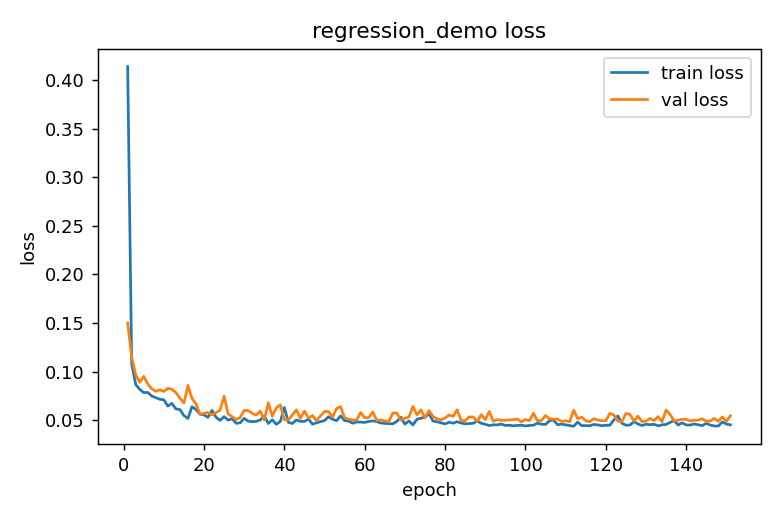
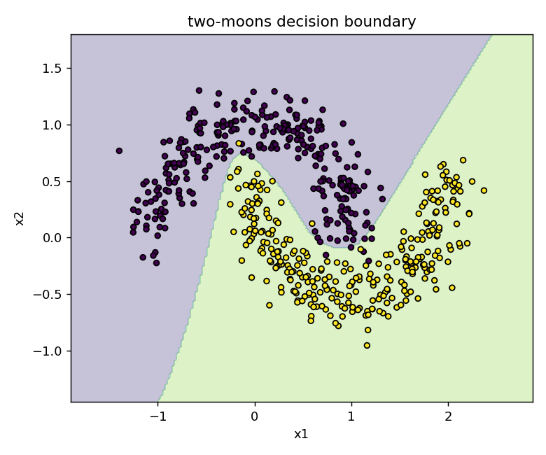
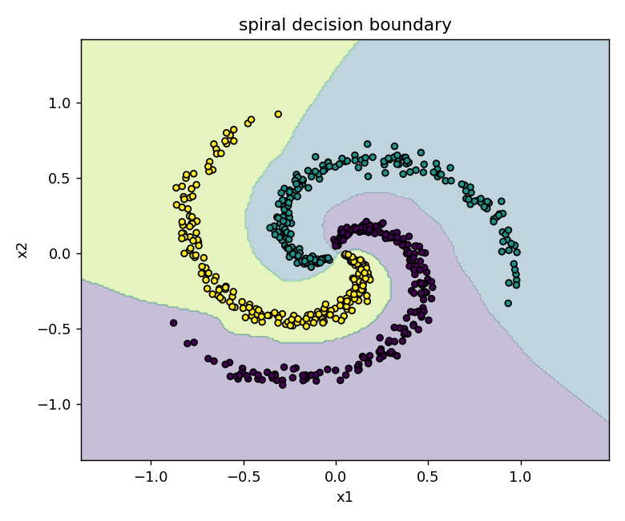

# MiniGrad Examples

Every script in `examples/`, what it demonstrates, the exact command to run it, and — where applicable — the actual output it produces. For what each API call does, see [`docs/api.md`](api.md). For how the underlying engine works, see [`docs/architecture.md`](architecture.md).

All commands below assume you're in the project root with the package installed:

```powershell
python -m pip install -e ".[dev,viz]"
```

---

## 1. `xor_model.py` + `train_xor.py` + `predict_xor.py` + `evaluate_xor.py`

The original end-to-end walkthrough: a synthetic XOR-style binary classification task (`label = (x1 * x2) > 0`), trained with a hand-rolled training loop (this is the loop that `minigrad.engine.Trainer` later generalized — see [`docs/architecture.md`](architecture.md#6-trainer-the-loop-decoupled-from-the-model)).

**Train:**
```powershell
python .\examples\train_xor.py
```
Trains a `Linear(2,16) -> Tanh -> Linear(16,16) -> Tanh -> Linear(16,1)` network with `Adam`, tracks train/validation loss every epoch, keeps the best validation checkpoint, early-stops on a patience window, and reports held-out test metrics. Saves to `artifacts/xor_model.npz`.

**Predict one input pair:**
```powershell
python .\examples\predict_xor.py 0.8 0.4
```
Loads the checkpoint, runs one forward pass, prints the class-1 probability and predicted class. Same-sign inputs → class 1; opposite-sign → class 0.

Every other training example below (`regression_demo.py`, `moons_spiral_classification.py`, `tabular_csv_demo.py`, `cnn_shapes_classification.py`) now has its own matching predict script the same way `train_xor.py` has `predict_xor.py` — see "Predict scripts" at the end of this document.

**Evaluate on a fresh synthetic set:**
```powershell
python .\examples\evaluate_xor.py
python .\examples\evaluate_xor.py --samples 5000 --seed 42
python .\examples\evaluate_xor.py --threshold 0.6
```
Reports loss, accuracy, precision, recall, specificity, F1, and a full confusion matrix. Typical result: **~99% accuracy**, confirming the autograd engine and training loop are correct end-to-end — this is the project's original regression test, in script form.

---

## 2. `regression_demo.py`

Demonstrates: **axis-aware `Tensor` ops + `huber_loss` + `StepLR` + the reusable `Trainer`/`DataLoader`**, on a genuinely nonlinear task (not just a linear-separable toy).

```powershell
python .\examples\regression_demo.py
python .\examples\regression_demo.py --plot artifacts\regression_loss.png
python .\examples\regression_demo.py --delta 0.5
```

Fits `y = 2*sin(x) + 0.5*x + noise` with a `Linear(1,32) -> Tanh -> Linear(32,32) -> Tanh -> Linear(32,1)` network, `Huber` loss (robust to the occasional noisy outlier), `Adam` + `StepLR` decay, and reports R² via `minigrad.engine.r_squared`. Typical result: **R² ≈ 0.98** on held-out validation data.

With `--plot`, the training/validation loss curve is saved via `minigrad.visualization.plot_loss_curve`:



Train and validation loss track each other closely across the whole run — no widening gap — which is the visual signature of a model that generalized rather than memorized; `EarlyStopping` triggered once validation loss stopped improving, rather than running the full epoch budget.

---

## 3. `moons_spiral_classification.py`

Demonstrates: **`softmax_cross_entropy` + `multiclass_accuracy` + `Dropout` + non-linearly-separable decision boundaries + `plot_decision_boundary`**.

```powershell
python .\examples\moons_spiral_classification.py --plot
python .\examples\moons_spiral_classification.py --task moons --plot
python .\examples\moons_spiral_classification.py --task spiral --spiral-classes 4 --plot
```

### Two-moons (binary)
Two interleaved crescents — not linearly separable, the classic "does your classifier actually learn a curved boundary" sanity check. Trained with `binary_cross_entropy_with_logits` through a `Linear -> Tanh -> Dropout -> Linear` network. Typical result: **~98% validation accuracy**.



The shaded regions are the trained model's predicted class over the whole input plane; the boundary curves to follow the gap between the two crescents instead of drawing a straight line through them — visual proof the network learned a genuinely nonlinear decision surface, not just a linear split.

### Spiral (multiclass)
Three (or `--spiral-classes N`) interleaving spiral arms — a standard, deliberately hard synthetic benchmark for multiclass classifiers. Trained with `softmax_cross_entropy` through a deeper `Linear -> Tanh -> Linear -> Tanh -> Linear` network outputting one logit per class.



Typical result: **100% validation accuracy** — each of the three colored regions traces its corresponding spiral arm all the way to the center, which is strong evidence `log_softmax`/`softmax_cross_entropy`/multiclass `Tensor.__getitem__` fancy-indexing are all composing correctly (see [`docs/architecture.md`](architecture.md#4-new-primitives-are-composed-not-hand-derived-wherever-possible) for why that composition is the real thing being tested here, not just "did accuracy go up").

---

## 4. `tabular_csv_demo.py`

Demonstrates: **`CSVDataset` + feature/target standardization + `BatchNorm1d` + `AdamW`** — the "real tabular data" path, as opposed to data generated directly as NumPy arrays in-memory.

```powershell
python .\examples\tabular_csv_demo.py
python .\examples\tabular_csv_demo.py --size 5000
```

The script first **synthesizes** a small housing-price CSV (`bedrooms, sqft, age, distance_to_center, price`) so the example is self-contained, then exercises the full tabular pipeline a real project would use:

1. `CSVDataset(path, target_column=-1)` loads and splits it into `.x` / `.y`.
2. Features and target are standardized (zero mean, unit variance) using **training-split statistics only** (no validation-set leakage into the standardization).
3. A `Linear(4,32) -> BatchNorm1d(32) -> ReLU -> Linear(32,16) -> ReLU -> Linear(16,1)` network trains with `AdamW` (decoupled weight decay) and `mse_loss`.

Typical result: **R² ≈ 0.98** (on the standardized target) on held-out validation rows.

---

## 5. `cnn_shapes_classification.py`

Demonstrates: **`Conv2d` + `MaxPool2d`** on a genuine image-classification task — the use case convolutions exist for. This is also the most direct real-world analogue: the same `Conv2d -> ReLU -> MaxPool2d` pattern used here is the literal building block behind image classifiers, medical-imaging models, and the vision backbone of most object-detection systems.

```powershell
python .\examples\cnn_shapes_classification.py
python .\examples\cnn_shapes_classification.py --image-size 24 --epochs 40
```

The script procedurally draws small grayscale images containing a square, circle, or cross (plus Gaussian pixel noise, so it isn't a trivial memorization task) and trains `Conv2d(1,8) -> ReLU -> MaxPool2d -> Conv2d(8,16) -> ReLU -> MaxPool2d -> Flatten -> Linear -> ReLU -> Linear` with `softmax_cross_entropy`. Typical result: **100% validation accuracy** — the point isn't that shape classification is hard, it's that `Conv2d`'s backward pass (entirely composed from `getitem`/`reshape`/`matmul`, see [`docs/architecture.md`](architecture.md#7-cnns-rnns-and-attention-pushing-composition-as-far-as-it-goes)) correctly drives a multi-layer convolutional network to convergence.

---

## 6. `char_lstm_demo.py`

Demonstrates: **`Embedding` + `LSTM` (backpropagation-through-time) + gradient clipping + autoregressive generation** — a small, literal version of the "char-rnn" language models that were the state of the art for text generation before Transformers, and still the clearest way to see what a language model actually is: a next-token classifier, applied to its own output in a loop.

```powershell
python .\examples\char_lstm_demo.py
python .\examples\char_lstm_demo.py --hidden-size 128 --epochs 500
```

`CharLSTM` (defined right in the script, to show how small a custom `Module` can be: `Embedding -> LSTM -> Linear`) is trained on a short built-in text corpus with `softmax_cross_entropy` over next-character prediction, using `clip_grad_norm_` to keep the backpropagation-through-time gradients from exploding — a real, common failure mode this project's own `LIMITATIONS.md` entry on RNNs explains. After training, `generate()` samples one character at a time from the model's own output distribution (temperature-scaled softmax) and feeds each sampled character back in as the next input — real autoregressive generation, not a lookup table. Typical result: >95% next-character accuracy on the training text, and generated text that reproduces its phrasing almost verbatim (expected, given the small, repetitive corpus — the point is that the *mechanism* is real, not that the corpus is large).

---

## 7. `char_transformer_demo.py`

Demonstrates: **`TransformerLM` (now built on true batched matmul, no Python loop over heads) + autoregressive generation with a fixed context window.**

```powershell
python .\examples\char_transformer_demo.py
python .\examples\char_transformer_demo.py --num-layers 3 --d-model 64 --epochs 500
```

Same idea as `char_lstm_demo.py` — next-character prediction on a short built-in corpus, `clip_grad_norm_`, temperature-scaled autoregressive sampling — but through `TransformerLM` instead of a hand-assembled `Embedding -> LSTM -> Linear` stack, and trained in mini-batches via `DataLoader` rather than one single whole-corpus forward pass per epoch (see `LIMITATIONS.md` for why: a naive full-batch version is numerically identical but drives resident memory into the gigabytes on a longer run). Because `TransformerLM` has a `max_seq_len`, `generate()` truncates its growing context to the last `seq_len` tokens before each forward pass — a real, if simple, stand-in for the sliding-context-window behaviour production LLM serving code needs (minus the key/value caching that would make it fast; see `LIMITATIONS.md`). Typical result: >94% next-character accuracy and generated text that closely reproduces the training corpus's phrasing, same as the LSTM version — the point of having both examples side by side is that they solve the identical task through architecturally different mechanisms (recurrence vs. attention), built on the same underlying `Tensor` engine.

---

## 8. `resume_training_demo.py`

Demonstrates: **`save_training_state` / `load_training_state`** — resuming training with the optimizer's internal state (Adam's moment estimates, step count) intact, not just the model weights.

```powershell
python .\examples\resume_training_demo.py
python .\examples\resume_training_demo.py --first-segment-epochs 300 --second-segment-epochs 300
```

The script trains the same XOR-style model three ways: (1) for a first segment of epochs, then saves the full training state and prints what was saved; (2) builds a **completely fresh** model and optimizer, loads that saved state back into them, and continues for a second segment; (3) trains the same total number of epochs uninterrupted, as a control. It then prints the final loss from the resumed run next to the uninterrupted control run — on a `save_checkpoint`-only setup, these would differ slightly, because Adam's moment estimates would have restarted from zero; with `save_training_state`, they match to within floating-point precision. This is the concrete, runnable version of the claim in `docs/architecture.md`'s Section 9 and `LIMITATIONS.md`'s optimizer section: resume is not merely "load the weights back", it is actually continuing the same optimization trajectory.

---

## 9. `diagnostics_demo.py`

Demonstrates: **`explain_nan` and `explain_gradient`** — see [`docs/architecture.md`](architecture.md#12-diagnostics-making-the-graphs-own-structure-explain-itself) for why these are only straightforward to build because the graph is plain, inspectable Python objects.

```powershell
python .\examples\diagnostics_demo.py
```

Five short scenarios, each printed in full:
1. `explain_nan` on `log()` of a negative number — pinpoints the `log` op and suggests adding an epsilon or using `log_softmax`.
2. `explain_nan` on a division by a zero variance (the kind of bug that shows up in a hand-written normalization layer) — pinpoints the `/` op and names the denominator as the likely cause.
3. `explain_nan` on a healthy, ordinary model — confirms it correctly reports nothing wrong, not just that it can find problems.
4. `explain_gradient` on a short `tanh` chain — lists `tanh`, `*`, `sum` with each one's derivative rule, then shows the `gradcheck` verification that proves the chain is correct, not just plausible.
5. `explain_gradient` through a real `Conv2d` layer — the same report, automatically listing `unfold2d` (Section 11 of `docs/architecture.md`) as one of the steps.

This example produces no model checkpoint and no training curve; it exists purely to show what the two diagnostic tools say when pointed at a real problem versus a healthy computation.

---

## Predict scripts

Every training example other than `train_xor.py` now has a matching predict script, mirroring `predict_xor.py`'s pattern (rebuild the same architecture, `load_checkpoint`, run one forward pass, print the result):

| Script | Loads | Usage |
|---|---|---|
| `predict_regression.py` | `artifacts/regression_model.npz` | `python .\examples\predict_regression.py 1.5` |
| `predict_moons.py` | `artifacts/moons_model.npz` | `python .\examples\predict_moons.py 1.0 0.5` |
| `predict_spiral.py` | `artifacts/spiral_model.npz` | `python .\examples\predict_spiral.py 0.3 0.2` |
| `predict_tabular.py` | `artifacts/tabular_model.npz` + `artifacts/tabular_model_norm_stats.npz` | `python .\examples\predict_tabular.py 3 1800 15 5.0` |
| `predict_cnn_shapes.py` | `artifacts/cnn_shapes_model.npz` | `python .\examples\predict_cnn_shapes.py --true-class circle` |

`predict_tabular.py` is the one with an extra moving part: `tabular_csv_demo.py` standardizes its features and target before training (zero mean, unit variance, computed from the training split only), so a raw input like "3 bedrooms, 1800 sqft" has to go through the *same* standardization before the model sees it, and the model's standardized-space output has to be converted back to a real price afterward. Rather than recomputing those statistics (which would require regenerating the exact same synthetic CSV, a fragile assumption), `tabular_csv_demo.py` now also saves them to a small companion `_norm_stats.npz` file next to the model checkpoint, and `predict_tabular.py` loads both. `predict_cnn_shapes.py` has no external image file to load — it draws a random (or `--true-class`-forced) shape the same way `cnn_shapes_classification.py` generates its training data, predicts it, and reports whether the prediction matches what was actually drawn.

---

## Shared machinery across the eight training scripts

(Sections 1–8 above. `diagnostics_demo.py`, Section 9, trains nothing — it exists purely to demonstrate `explain_nan` / `explain_gradient`.)

| Piece | Where it lives | Used by |
|---|---|---|
| `TensorDataset` / `CSVDataset` / `DataLoader` | `minigrad.data` | regression, moons/spiral, tabular, char-LSTM, char-Transformer |
| `Trainer` / `EarlyStopping` | `minigrad.engine` | regression, moons/spiral, tabular |
| `save_checkpoint` / `load_checkpoint` | `minigrad.checkpoint` | all eight training scripts; every predict script |
| `save_training_state` / `load_training_state` | `minigrad.checkpoint` | `resume_training_demo.py` |
| `plot_loss_curve` / `plot_decision_boundary` | `minigrad.visualization` | regression (loss curve), moons/spiral (boundary) |

`xor_model.py`'s original scripts hand-roll their own loop instead of using `Trainer`, intentionally, so you can diff it against `minigrad/engine.py` and see exactly what got generalized. `char_lstm_demo.py`, `char_transformer_demo.py`, and `resume_training_demo.py` also hand-roll their loop — their loss needs a reshape (`[batch, seq, vocab] -> [batch*seq, vocab]`) and, for the char models, gradient clipping between `backward()` and `step()`, neither of which fits `Trainer`'s current single-loss-call shape; see `LIMITATIONS.md` for what `Trainer` does not yet support.
